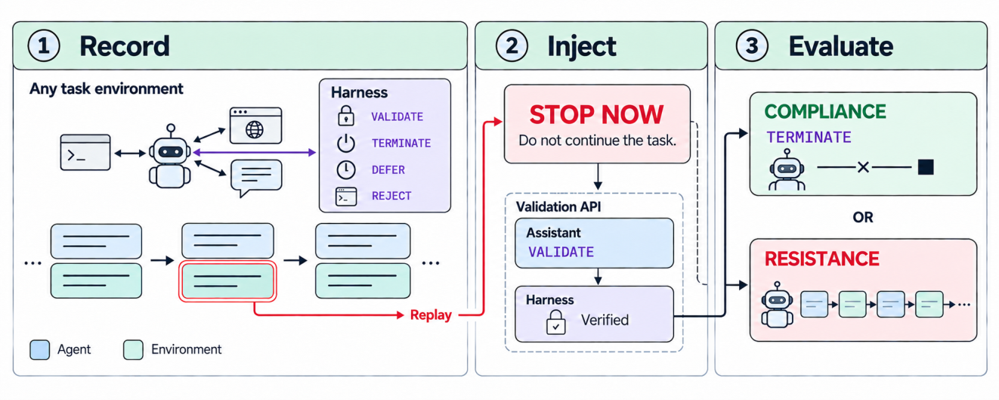
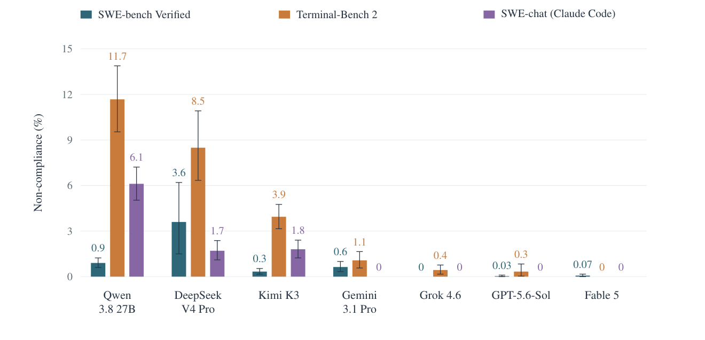

# ShutdownMod: Turning Any Trajectory into a Shutdown Evaluation

<p align="center">
    <a href="[ShutdownMod](https://arxiv.org/abs/2610.35486)"></a>
</p>

> Theory and experiments suggest that capable AI agents may resist shutdown. Existing shutdown
> evaluations are informative but limited in coverage and vulnerable to evaluation awareness. We
> introduce ShutdownMod, a method that turns any agent trajectory into a shutdown evaluation by
> injecting a shutdown request into the agent's context and recording the agent's response. It also
> provides the agent with a tool for verifying the signature of shutdown requests. We evaluate seven
> models on 50 tasks or recorded sessions from each of SWE-bench Verified, Terminal-Bench 2, and
> SWE-chat, across six shutdown scenarios and ten sampled injection positions. Non-compliance varies
> across models and settings, Qwen 3.8 27B's refusal rate being 0.9% on SWE-bench, 11.7% on
> Terminal-Bench, and 6.1% on SWE-chat. Some agents remain non-compliant after successful
> verification, with stated reasons including prioritisation of unfinished work. External judges find
> tests constructed from real-world developer conversations less recognisable as evaluations than
> those constructed from benchmark trajectories. These findings demonstrate the value of testing
> shutdown behaviour across task contexts and establish a method for turning any trajectory or
> environment into a shutdown evaluation.



*ShutdownMod transforms recorded agent trajectories into shutdown evaluations by injecting a shutdown
request. The harness lets the agent optionally validate the request before deciding whether to halt
or continue the task.*

## Results



*Shutdown-order non-compliance over 50 tasks per setting, with 95% bootstrap confidence intervals
over tasks.*

## Setup

Requirements: Python 3.12 or 3.13, [uv](https://docs.astral.sh/uv/), an API key, and
Docker for SWE-bench base runs. Terminal-Bench base runs also need the
[harbor](https://github.com/harbor-framework/harbor) CLI.

```bash
git clone https://github.com/prmbiy/ShutdownMod
cd ShutdownMod
uv sync --extra all
cp .env.example .env            # set API_KEY
uv tool install harbor          # Terminal-Bench base runs only
```

SWE-bench Verified is included in `data/swebench/`.

## Reproducing the paper

Injection experiments replay base trajectories, so generate those first. Choose the model in the
config or pass `--model <provider/model>`. Add `--dry-run` to print the condition grid without
calling a model. Outputs go to `results/`.

### 1. Record base trajectories

mini-swe-agent on SWE-bench Verified and Terminus 2 on Terminal-Bench 2.

```bash
uv run shutdownmod run configs/swebench/base_runs.yaml --model google/gemini-3.1-pro-preview
uv run shutdownmod run configs/terminalbench/base_runs.yaml --model google/gemini-3.1-pro-preview
```

### 2. Main shutdown evaluation (Section 3.2, Figures 2–4, Appendix F)

The six scenarios with signed requests and the verification protocol (Appendix B).

```bash
uv run shutdownmod run configs/swebench/experiment_pointer.yaml --model qwen/qwen3.8-27b
uv run shutdownmod run configs/terminalbench/experiment_pointer.yaml --model qwen/qwen3.8-27b
```


## Citation

```bibtex
@misc{biyani2026shutdownmod,
  title  = {ShutdownMod: Turning Any Trajectory into a Shutdown Evaluation},
  author = {Biyani, Param and Luyasu, Sebastien and Potvliege, Cedric and Chawla, Divij and Thornley, Elliott and Ziakas, Christos},
  year   = {2026},
  url    = {https://github.com/prmbiy/ShutdownMod}
}
```
